# KoMaP 2026 알루미늄 합금 상 분할

2026 KoMaP AI 경진대회 과제(고탄성 알루미늄 합금 광학현미경 이미지의 4클래스 상 분할) 제출본 코드다.
4개 상은 Al 기지, Al₃Ni, 초정 Si(Primary Si), 공정 Si(Eutectic Si)다. 2026-10-15에 제출한 시점의
코드만 담았다.

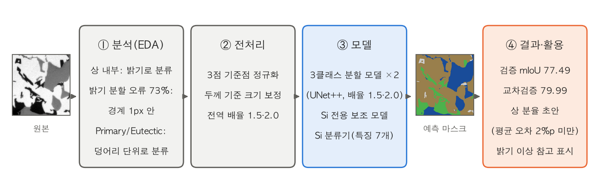

검증 이미지 20장의 4클래스 mIoU는 77.49(공식 산식), 같은 구성의 학습 70장 교차검증은 79.99다. 사진마다 네 상의
area fraction(면적 비율)을 자동으로 만들며, 검증 20장 평균 절대 오차는 2%p 미만이다.

## 전체 구조와 처리 순서

1. **3클래스 분할 신경망**: Al 기지, Al₃Ni, Si 세 클래스로 먼저 나눈다. 해상도 배율 1.5배와 2.0배로 학습한 두
   실험(`w2_res_s15`, `w2_res_s20`)의 5폴드 모델을 반전 4방향으로 추론(TTA)해 평균한다.
2. **Si 전용 보조 모델**: Si 영역 안에서 Primary/Eutectic 두 클래스 확률을 낸다(`w4_prob2_si2`, 5폴드).
3. **Si 분류기**: Si 덩어리(connected component, 상하좌우로 이어진 픽셀 영역)마다 Primary/Eutectic을 판정해 최종
   4클래스 마스크를 만든다.

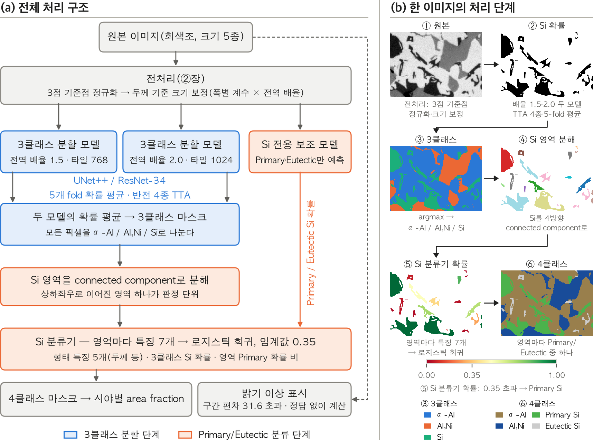

**그림 6. 전체 처리 구조와 한 이미지의 처리 단계.** (a) 파랑은 3클래스 분할 단계, 주황은 Primary/Eutectic 분류
단계다. 맨 아래 회색 두 상자(area fraction, 밝기 이상 표시)는 저장된 마스크와 원본으로 따로 계산하는 분석
단계이며 제출 코드에는 없다. (b) 검증 이미지 한 장이 각 단계를 거치는 모습이다.

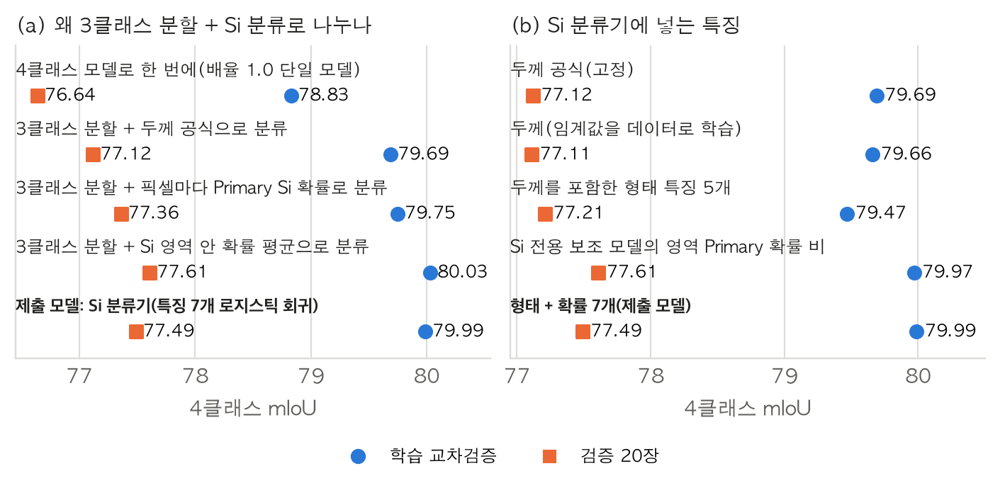

**그림 7. 나눠 푸는 이유와 Si 분류기의 입력.** 4클래스를 한 번에 푼 모델(78.83)보다 3클래스로 나눈 뒤 Si를 따로
분류한 방식이 모두 높았다(79.69~80.03, 학습 교차검증). 다만 4클래스 모델은 배율 1.0 단일 모델이라 해상도
차이가 함께 섞여 있다. 같은 3클래스 분할 위에서는 두께 공식 79.69, 픽셀마다 보조 모델 확률 79.75, 덩어리 안
확률 평균 80.03 순이어서, 픽셀이 아니라 덩어리 단위로 정하는 쪽이 나았다(검증 20장도 77.12 < 77.36 < 77.61).

## 설계 근거: 데이터 분석과 전처리

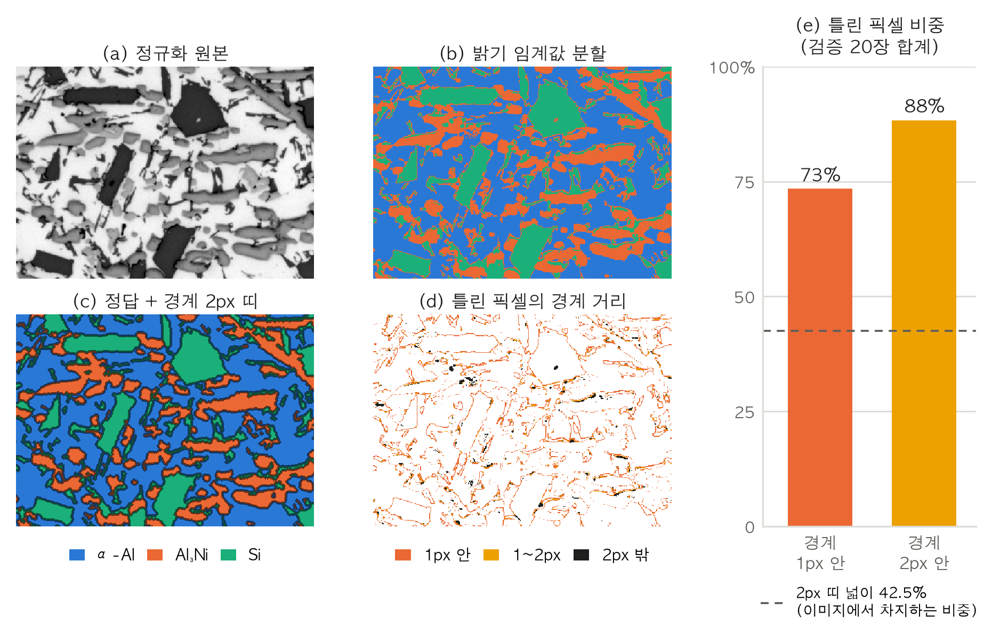

**그림 1. 경계 2px 띠와 밝기 임계값 분할이 틀리는 자리.** 밝기를 정규화한 뒤 이미지별 최적 임계값으로 나눠도
틀린 픽셀은 정답 경계에 몰린다. 경계 띠는 이미지의 42.5%인데 틀린 픽셀의 88%가 이 띠 안에, 73%가 1px 안에 있다.
그래서 상 내부가 아니라 경계 복원을 분할 모델의 핵심 과제로 봤다.

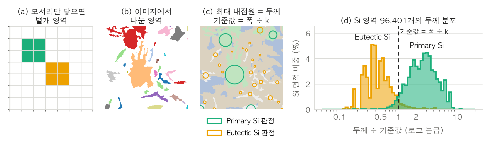

**그림 2. connected component와 두께의 뜻.** 같은 클래스 픽셀이 상하좌우로 맞닿으면 한 영역이다. 정답은 밝기가
겹치는 두 Si를 이 영역 단위로 나눴고, 그래서 Si 덩어리 하나를 Primary/Eutectic 판정의 단위로 쓴다.
(d)는 90장의 Si 영역 96,401개를 두께 ÷ 기준값으로 늘어놓고 면적으로 가중한 분포다.

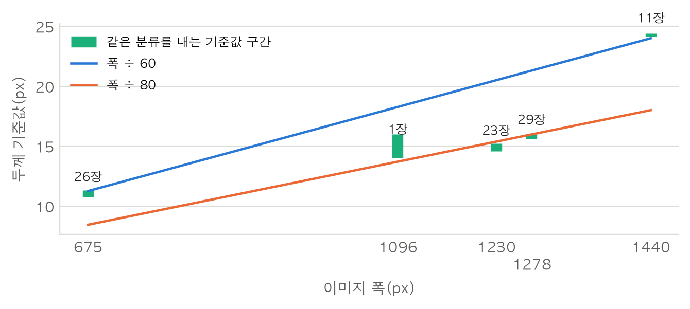

**그림 3. 이미지 폭별로 정답 마스크에서 찾은 Primary/Eutectic 두께 기준값.** 이미지 폭은 5종(675·1096·1230·
1278·1440px)이다. 675px과 1440px의 기준값 비는 2.14배로 폭의 비(2.13배)와 거의 같아, 이 비를 크기 그룹별
보정 계수로 쓴다.

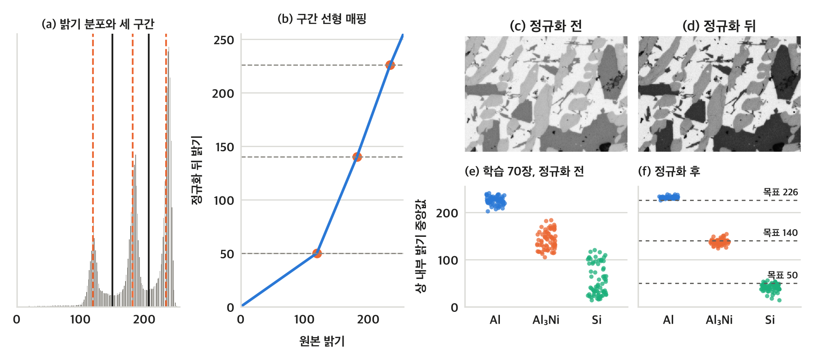

**그림 4. 3점 기준점 정규화의 절차와 효과.** 밝기 분포를 Multi-Otsu로 어두운·중간·밝은 세 구간으로 나누고, 세
구간 평균을 50·140·226에 구간 선형으로 맞춘다. 정규화 뒤 세 상의 내부 밝기가 각자의 띠로 모인다. 정답
마스크를 쓰지 않으므로 새 이미지에도 그대로 쓸 수 있다.

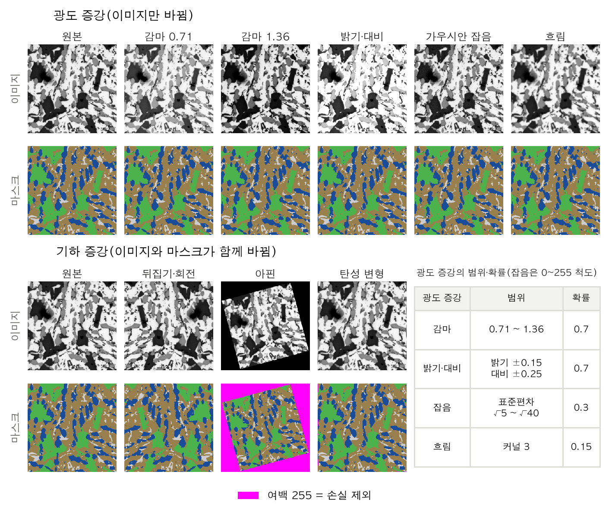

**그림 5. 학습 때 거는 증강의 예.** 광도 증강(위 두 줄)과 기하 증강(아래 두 줄)을 범위의 끝값으로 걸었다. 기하
증강이 만든 여백은 마스크에서 255(자홍)로 칠해 손실에서 뺀다.

## 결과

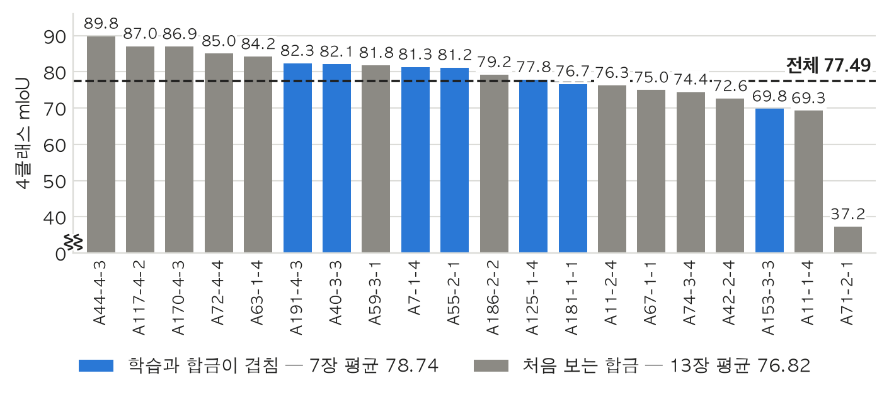

**그림 8. 검증 20장의 이미지별 4클래스 mIoU(공식 산식).** 학습 70장으로 학습한 모델로 검증 20장을 예측했다.
학습 데이터와 합금이 겹치는 7장은 78.74, 처음 보는 합금 13장은 76.82다. 점선은 전체 평균(77.49)이다.

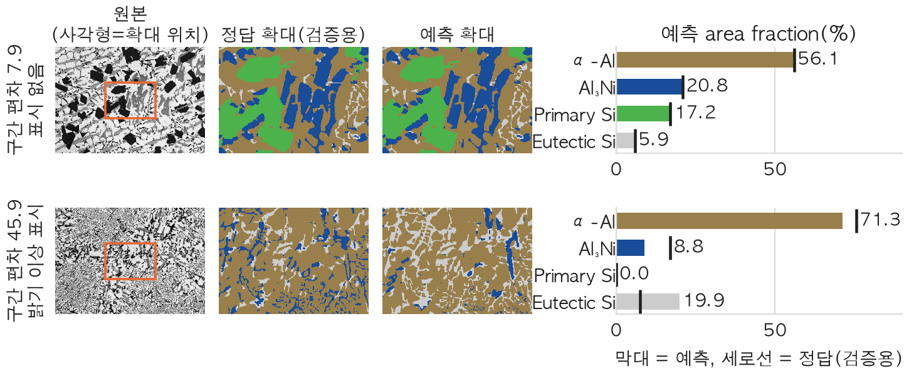

**그림 9. 검증 20장에서 점수가 가장 높은 이미지(mIoU 89.8)와 가장 낮은 이미지(37.2)의 예측과 상 분율.** 아래
이미지는 Al₃Ni가 정규화 뒤에도 밝기 103으로 학습 범위(124~154)보다 어두워, 파란 침상 미세조직의 65%를
Eutectic Si로 예측했고 분율 오차가 12.40%p였다. 이 이미지에는 밝기 이상 표시가 붙는다.

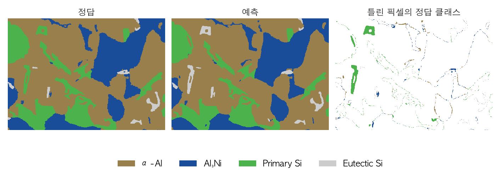

**그림 10. 예측이 정답과 다른 픽셀의 위치.** 검증 이미지 한 장의 가운데 영역에서 틀린 픽셀을 정답 클래스 색으로
칠했다.

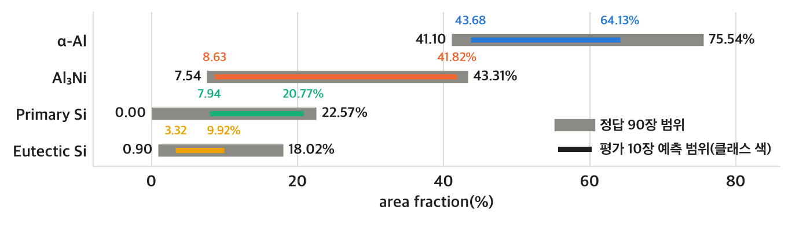

**그림 11. 평가 10장의 예측 area fraction 범위.** 색은 평가 10장 예측, 회색은 학습·검증 90장 정답의 범위다. 네
클래스 모두 예측이 정답 범위 안에 든다.

그림은 모두 제출한 모델링 결과서([result_report.pdf](result_report.pdf), 14쪽)에 실은 것이다.

## 폴더 구조

| 폴더·파일 | 들어 있는 것 |
|---|---|
| `src/komap/` | 제출 모델의 학습·추론 코드(패키지 본체) |
| `src/komap/experiments/` | Si 분류기 학습(`reclass_fit.py`)과 그 비교 채점 도구(`cheap_wins.py`) |
| `src/komap/baselines/` | 학습 없이 밝기 임계값 2개로 나누는 규칙 기반 대조군(학습 코드가 참조) |
| `scripts/predict_test.sh` | 평가 이미지 추론(대회에 제출한 명령) |
| `tests/` | pytest 테스트 22개 파일. 산식·전처리·증강·추론·후처리·Si 분류기를 데이터 없이 검사 |
| `assets/` | README 그림(결과서 그림 12장) |
| `result_report.pdf` | 대회에 제출한 모델링 결과서(14쪽) |

`src/komap/`에서 제출 모델이 실제로 거치는 순서는 다음과 같다.

| 단계 | 파일 | 하는 일 |
|---|---|---|
| 입출력 | `io.py`, `config.py` | 파일명 파싱, 이미지·마스크 읽기, 색상↔클래스 변환 / 전역 상수(시드·경로·클래스) |
| 전처리 | `preprocess.py` | 3점 기준점 밝기 정규화, 이미지 폭에 따른 배율 정규화(정답 없이 계산) |
| 학습 데이터 | `dataset.py`, `augment.py`, `cv.py` | 타일 데이터셋, 광도·기하 증강, 합금 단위 5겹 교차검증 분할 |
| 학습 | `model.py`, `losses.py`, `train.py` | 분할 모델(segmentation_models_pytorch) 생성, 손실 함수, fold 하나 학습 |
| 추론 | `infer.py`, `predict.py` | 겹치는 타일 + 가우시안 블렌딩 + 반전 TTA로 확률 맵 / fold·실험 앙상블에서 최종 PNG까지 |
| Si 판정 | `si2.py`, `reclass.py`, `combine.py`, `postprocess.py`, `shape.py` | Si 전용 보조 모델 출력 변환, Si 덩어리 특징과 로지스틱 분류기, 확률 맵을 4클래스 마스크로 결합 |
| 평가 | `metrics.py`, `oof.py` | 대회 산식(이미지별 4클래스 IoU 평균), 교차검증 OOF 확률 모으기 |

`edge_aux.py`(경계 보조 헤드), `ridge.py`(능선 검출기), `hint.py`(규칙 힌트 채널)는 시험했지만 제출 구성에서는 끈
선택지다. 학습 코드가 옵션으로 불러 쓰므로 남겨 두었다.

## 설치

Python 3.12 기준이다. 개발 환경은 macOS(Apple Silicon)다.

```bash
python3.12 -m venv .venv
source .venv/bin/activate
pip install -r requirements.txt
pip install --no-deps -e .
```

## 실행

데이터는 `data/1train`, `data/2valid`, `data/3test` 아래 `images/`(·`masks/`)에 두고, 가중치는 `runs/`에 둔다.

```bash
# 평가용 이미지 추론(제출 명령)
bash scripts/predict_test.sh            # --device cpu 처럼 장치 지정 가능

# 위 스크립트가 실행하는 명령
python -m komap.predict --exp w2_res_s15,w2_res_s20 --prob4-exp w4_prob2_si2 --combiner learned --split test

# fold 하나 학습(인자는 python -m komap.train --help)
python -m komap.train --exp <실험이름> --fold 0

# Si 재분류기 학습
python -m komap.experiments.reclass_fit

# 테스트
KOMAP_DEVICE=cpu python -m pytest
```

추론 결과는 `runs/w2_res_s15+w2_res_s20/pred_test_nohalo_learned/*_mask.png`로 저장된다. 데이터·가중치 경로는
현재 폴더가 아니라 저장소 루트(`src/komap/config.py`의 `ROOT`) 기준이다.

## 포함하지 않은 것

- 대회 데이터(이미지·정답 마스크): 주최 측 데이터라 올리지 않는다. README 그림에는 결과서에 실은 대회 이미지 일부가 들어 있다.
- 학습된 가중치(`.pt` 15개)와 Si 재분류기(`.pkl`): 용량 문제로 제외했다. 따라서 이 저장소만으로는 추론이 돌지 않는다.
- 대회 기간의 실험 기록·분석 스크립트·실험 연쇄 실행 스크립트: 제출 모델을 쓰고 이해하는 데 필요한 코드만 남겼다.
